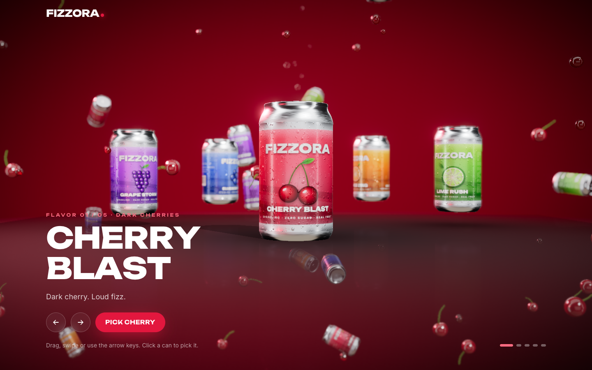

# Fizzora



An interactive 3D product site for **Fizzora**, a fictional sparkling fruit soda with five flavors. It is a portfolio and pitch demo: there is no backend, checkout or real e-commerce, and every button that looks like a purchase is visual only.

Everything in the 3D scene is generated in code. There are no model files, HDRIs or image textures: the cans, printed labels, condensation, fruit and liquid are all built procedurally at load time.

---

## Contents

- [Features](#features)
- [Tech stack](#tech-stack)
- [Getting started](#getting-started)
- [URL switches](#url-switches)
- [How the experience works](#how-the-experience-works)
- [Rendering and realism](#rendering-and-realism)
- [Performance tiers](#performance-tiers)
- [Accessibility](#accessibility)
- [Project structure](#project-structure)
- [Editing content](#editing-content)
- [Browser support and fallbacks](#browser-support-and-fallbacks)
- [Known issues](#known-issues)

---

## Features

**Hero carousel**
- The five cans sit on a ring and rotate with spring easing.
- You can rotate it by dragging, with a touch swipe, with the arrow buttons or arrow keys, or with the mouse wheel.
- The front can floats and tilts toward the cursor.
- The backdrop, lights, fog and floating fruit all cross-fade to the focused drink's colors.
- Picking a can lifts and spins it, moves the camera in, fires a liquid splash with that drink's fruit flying out, and swaps the headline. An **Explore** button then invites you to scroll.
- Scrolling stays locked until a drink is picked, so the experience always starts with a choice.

**Scroll sections.** One persistent fixed canvas sits behind the page. The featured can moves, rotates and scales from section to section:

| # | Section | 3D choreography |
| --- | --- | --- |
| 1 | Flavor story | Can spins while fruit orbits it; a splash fires as the section settles |
| 2 | Ingredients | Fruit flies in and clusters around the can; ingredient rows reveal in a stagger |
| 3 | Nutrition facts | Can rotates slowly beside a nutrition panel with count-up numbers |
| 4 | Features | Can recedes behind tilt-on-hover feature cards while background cans drift |
| 5 | Flavor wheel | Interactive wheel (sweet, sour, fizzy, fruity, tangy, refreshing) with animated fills |
| 6 | Closing | All five cans burst into a line-up with a finale splash; **Pick your flavor** scrolls back to the carousel |

**Throughout the page**
- Background cans tumble at many depths with scroll parallax, and fruit bits and liquid droplets float everywhere, matched to the selected drink.
- A sticky drink selector in the header re-themes the whole page at any time, including mid-scroll.
- Headlines have animated letters, sections reveal on scroll, and every interactive element has a hover state.
- A branded loading screen tracks the procedural asset generation.

---

## Tech stack

| Area | Library |
| --- | --- |
| Build | Vite, React 19, TypeScript (strict, no `any`) |
| 3D | three (pinned to `~0.182`, see [Known issues](#known-issues)), @react-three/fiber, @react-three/drei |
| Post-processing | @react-three/postprocessing (high tier only) |
| Scroll | Lenis smooth scroll, GSAP + ScrollTrigger |
| UI motion | Framer Motion |
| State | Zustand |
| Styling | Tailwind CSS v4 |
| Fonts | Unbounded (display) and Inter (body), self-hosted through `@fontsource-variable` |
| Lint | oxlint with the React, TypeScript and jsx-a11y plugins |

---

## Getting started

Requires Node 20 or newer.

```bash
npm install
npm run dev        # dev server on http://localhost:5173
```

| Script | What it does |
| --- | --- |
| `npm run dev` | Start the Vite dev server |
| `npm run build` | Typecheck (`tsc -b`), then build to `dist/` |
| `npm run preview` | Serve the production build |
| `npm run lint` | Run oxlint; any warning fails |
| `npm run typecheck` | TypeScript only |
| `npm run check` | Lint, then build |

The output in `dist/` is a static site and can be hosted anywhere (Netlify, Vercel, Cloudflare Pages, S3, and so on).

---

## URL switches

These query parameters make demos and QA easier:

| Query | Effect |
| --- | --- |
| `?tier=high`, `?tier=mid`, `?tier=low` | Force a quality tier and turn off automatic tier changes |
| `?reduced-motion` | Use the same calm path as the OS "reduce motion" setting |
| `?no-webgl` | Show the static, non-WebGL fallback |

They can be combined, for example `/?tier=low&reduced-motion`.

---

## How the experience works

### One continuous section position

`SmoothScroll` measures the center of every `[data-section]` element. On each scroll event it writes a continuous **section position** to the store: `0` is the hero, `1` is the flavor story, and so on up to `6` for the closing section. Values in between blend from one section to the next.

`HeroCans` turns that single number into a pose for each of the five cans:

- `0`: carousel slots on the ring
- `1` to `5`: the featured can follows per-section keyframes (`scene/layout.ts`), placed in screen-relative coordinates so it lands on the correct side of the copy at any aspect ratio, with separate keyframes for narrow screens
- `5` to `6`: all five cans fly into the finale line-up

The other four cans fly up out of frame while you are in the middle sections. Every transform is eased toward its target each frame, so nothing ever jumps.

### Keeping React out of the frame loop

High-frequency values (scroll position, pointer, drag offset, the featured can's world position, animated theme colors) live in the Zustand store or the mutable `sceneState` object and are read inside `useFrame`. Scrolling and pointer movement never re-render React components.

### Bursts

A splash is an event in the store (`fireBurst('small' | 'big' | 'finale')`). Subscribers (the crown, ribbon, droplets, fruit and fizz) each react independently at the can opening. Bursts fire:

- big, when a drink is picked
- small, when the drink changes after picking, and when the page settles into a new section
- finale, when the page settles into the closing section

Reduced motion skips them all.

---

## Rendering and realism

### Lighting and color
- drei `Environment` built from `Lightformer` softboxes, strip lights and a ring, so the metal gets studio reflections without downloading an HDRI.
- A white key light, plus rim and fill lights tinted with the active drink's colors, eased toward each new drink.
- ACES Filmic tone mapping, sRGB output and tuned exposure.
- Contact shadows under the carousel on every tier, and real shadows from the key light on desktop.

### Cans
- **Geometry.** Lathe profiles for the label body, the base dome and chime, the neck and rim, and a recessed lid. The extruded pull tab and rivet are merged into one geometry with a group per material, which lets the background cans be instanced.
- **Label.** Drawn on a canvas for each drink: brand, flavor name, fruit illustration, color gradients, a back panel and a barcode.
- **Surface maps.** A packed roughness and metalness map gives the label a painted finish with bare-aluminum rim bands. A clearcoat makes highlights glide across the label as the can turns.
- **Cold-can effect.** Condensation droplets and running drips are generated as a height map and converted to a normal map, with glossier droplets and a faint frost near the top and bottom of the label.
- **Bare metal.** The metal parts use a brushed-metal normal map, and the lid has its own normal map with the opening score and the rivet.

### Fruit
Cherries, lime and orange wheels and wedges, blueberries, single grapes and grape clusters. Materials use clearcoat and sheen, normal maps with water beads and citrus peel pores, and segmented citrus cut faces with a soft emissive glow to suggest translucency.

### Liquid
- On mid and high tiers, drei `MeshTransmissionMaterial` uses three's shared transmission pass, so all the liquid shares one extra render. It refracts and reflects the scene with slight chromatic aberration.
- The **crown splash** is a displaced ring wall with a spiky rim.
- The **ribbon** is a tapered tube that arcs out of the can, drawn head first and erased tail last.
- **Droplets** are instanced and fall under gravity with drag, stretching along their velocity and shrinking out at the end of their life.
- **Fizz** bubbles rise from the opening and swell just before they pop. **Blobs** float near the can and wobble.

### Post-processing (high tier only)
Bloom on highlights, depth of field that keeps the featured can sharp and softens distant cans, a soft reflective floor under the carousel, a vignette and SMAA.

---

## Performance tiers

The starting tier is guessed from the device: phones start on **low**, low-core or low-memory machines on **mid**, everything else on **high**. drei's `PerformanceMonitor` then moves it up or down at runtime. Phones can climb to mid at most.

| | High | Mid | Low |
| --- | --- | --- | --- |
| Liquid | Transmission, full-resolution refraction | Transmission, half-resolution refraction | Fresnel + environment reflection shader |
| Bloom, depth of field, SMAA, vignette | Yes | No | No |
| Reflective floor | Yes | No | No |
| Key-light shadows (desktop only) | Yes | Yes | No |
| Studio environment, contact shadows | Yes | Yes | Yes |
| Pixel ratio cap | 1.5 | 1.25 | 1 |

Particle and object budgets for each tier are in `src/lib/quality.ts`. Small screens get fewer floating objects on top of that.

Other measures:
- Repeated objects (background cans, fruit, droplets, bubbles) are instanced.
- Geometry, materials and every generated texture are created once and cached.
- Texture generation yields between steps so the loader keeps animating.
- Shaders compile before the loader hides.
- Contact shadows and the reflective floor stop rendering once you scroll past the hero.

---

## Accessibility

- All copy is real HTML text over the canvas; nothing readable is baked into WebGL. The 3D canvas is `aria-hidden`.
- **Keyboard**
  - Arrow keys rotate the carousel while the hero is on screen.
  - Buttons cover previous, next, pick, explore and jump-to-flavor.
  - The drink selector is a native radio group, so arrow keys move between flavors.
  - Every control has a visible focus ring.
- **Screen readers**
  - A live region announces the focused flavor.
  - Animated headings expose their plain text, and count-up numbers expose their final values.
  - The flavor wheel has an equivalent list of buttons.
- There is a skip link. Content below the hero is `inert` while scrolling is locked.
- With reduced motion (OS setting or `?reduced-motion`), smooth scrolling and splash bursts are off, scene motion is damped, and text reveals become simple fades.

---

## Project structure

```
src/
  main.tsx                Device detection, initial store state, React root
  App.tsx                 Page layout: canvas or fallback, header, sections, loader
  index.css               Tailwind, theme tokens (animated via @property), shared component classes
  data/
    drinks.ts             All drink content and types
  store/
    useAppStore.ts        Active drink, carousel, selection, bursts, tier, scroll position
  hooks/
    useEnvironmentSync.ts Live reduced-motion / screen-size flags and pointer tracking
    useQuality.ts         Per-tier budgets for the current device
  lib/
    device.ts             Initial tier guess, URL switches, WebGL support check
    quality.ts            Particle and object budgets
    scroll.ts             Lenis instance and scroll helpers
    math.ts, random.ts    Easing, damping, springs, seeded PRNG
    textures/             Canvas generators: labels, fruit art, condensation, metal, lid, fruit maps
  scene/
    Experience.tsx        The fixed <Canvas>, error boundary, context-loss handling
    SceneContent.tsx      Everything inside the canvas (suspends until textures exist)
    HeroCans.tsx          Carousel, section and finale poses for the five featured cans
    layout.ts             Pose math and per-section keyframes
    CameraRig.tsx         Dolly-in on pick, pointer parallax
    HeroStage.tsx         Floor: contact shadows, shadow catcher, reflective floor
    Effects.tsx           Post-processing (high tier)
    PerformanceTier.tsx   PerformanceMonitor wiring
    ReadySignal.tsx       Shader precompile and "scene ready" signal for the loader
    sceneState.ts         Mutable per-frame shared state
    can/                  Can geometry and materials
    fruits/               Fruit geometry, materials, instanced swarm, section fruit
    liquid/               Liquid material, crown, ribbon, droplets, fruit burst, fizz, blobs
    lighting/             Environment, stage lights, backdrop, theme color easing
    ambient/              Floating cans, fruit and droplets
  sections/               Hero, FlavorStory, Ingredients, Nutrition, Features, FlavorWheel, ClosingCta
  components/             Loader, header, drink selector, kinetic heading, reveal, count-up, tilt card, fallback art
```

---

## Editing content

All drink content is in `src/data/drinks.ts`, typed by the `Drink` interface. Each drink has:

- name, short name, tagline and story
- fruit type
- colors (accent, light, deep, page background, liquid, text on accent)
- flavor notes and ingredients
- nutrition facts and feature cards
- a 0 to 100 flavor profile used by the wheel

Labels, theme colors, fruit and copy all update from that file. A sixth drink would also need a fruit type in `scene/fruits/fruitPieces.ts` and a label illustration in `lib/textures/fruitArt.ts` if it uses a fruit that isn't there yet.

---

## Browser support and fallbacks

- Built for current evergreen browsers (Chrome, Edge, Safari, Firefox).
- If WebGL is unavailable, fails to start, throws while rendering, or loses its context, the page switches to a static fallback: a CSS backdrop in the drink's colors and flat SVG cans. The selector, sections and theme switching keep working.
- Layout is responsive from 375 px wide up. On narrow screens the featured can sits in the upper part of the viewport and the copy is placed below it.

---

## Known issues

- **three is pinned to `~0.182`.** three 0.183+ deprecated `THREE.Clock`, which @react-three/fiber 9.8 still creates, so it prints a console warning. Unpin three once R3F moves to `THREE.Timer`.
- **SMAA instead of MSAA on the high tier.** Multisampled targets combined with bloom rendered a black frame on ANGLE/Metal during testing.
- **Fruit slice translucency is faked** with an emissive glow rather than real refraction, to keep many fruit pieces cheap.
- **Small overlaps.** At 1440 px the small "Flavor 01 / 05" label under the hero title slightly overlaps the bottom of the left can. On phones, the featured can overlaps the top of the taller sections (nutrition, flavor wheel) as you scroll through them.
- **Large 3D bundle.** The three / R3F chunk is about 1.18 MB (about 354 KB gzipped), so the first load is heavy.
- **Testing limits.** Testing was done in desktop and mobile-emulated Chromium. Touch drag has not been verified on a physical phone.

---

Fizzora is a fictional brand created for a design and engineering demo. No products are for sale.
